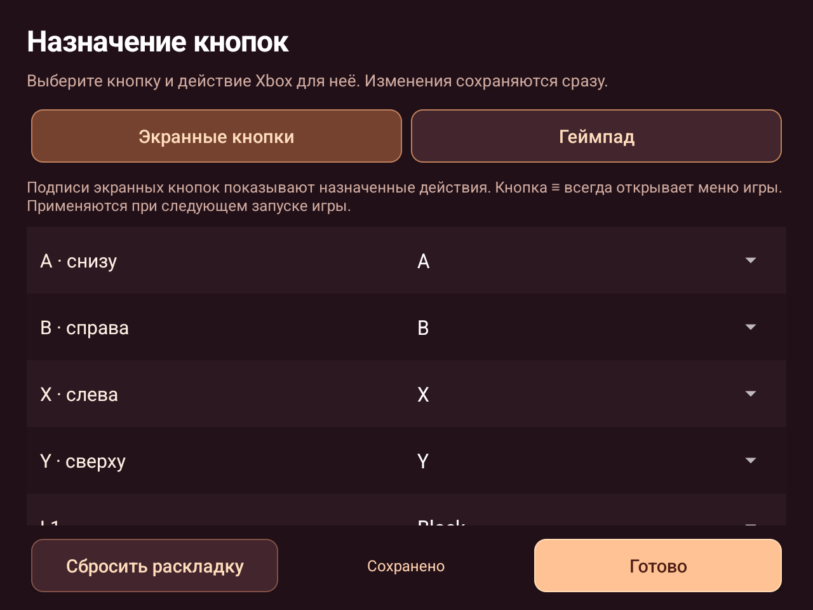
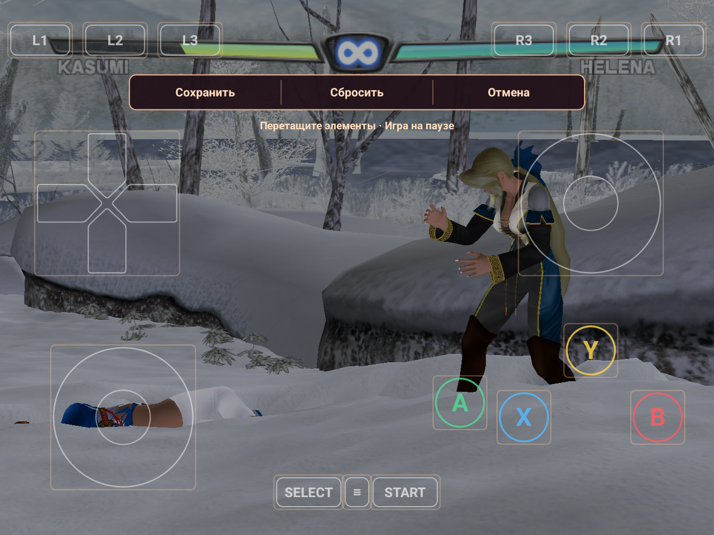
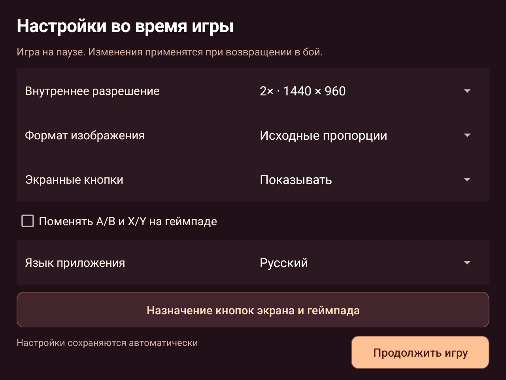

  

<h1 align="center">DOA3</h1>

<b>Dead or Alive 3 · Android · ARM64</b>

  
  
  
  

<a href="README.md">Русский</a> · <b>English</b>

  <a href="https://github.com/Wannamingo/DOA3/releases/download/v0.1.0-alpha3/DOA3.apk"><b>Download APK</b></a> ·
  <a href="https://github.com/Wannamingo/DOA3/releases">All releases</a> ·
  <a href="https://github.com/Wannamingo/DOA3/issues/new/choose">Report a bug</a>

Unofficial native Android port of **Dead or Alive 3**. The game's x86 code is statically recompiled for ARM64; graphics use OpenGL ES 3, while audio and input use SDL3. The launcher follows [DOAXBV](https://github.com/Wannamingo/DoAXBV), with gamepad support, touch controls and import from your own USA ISO.

**Alpha build:** startup, menus and a fight have been tested on RG477M. Full completion, every character, arena and effect have not been tested; some renderer commands can still be declined. Performance varies by scene and device.

Your own original USA game copy is required. ISO images, XBE files and game-data archives are not distributed in this repository or its releases.

## Version

| Component | Value |
| --- | --- |
| APK | `0.1.0-alpha3` |
| Android package | `org.doa3.port` |
| Native core | DOA3 USA, ARM64 |
| Tested device | RG477M, Android 14 / GammaOS, Mali-G615 MC6 |

## Features

- All settings are available in-game: tap ⚙ beside FPS or use Select → Settings. Resolution, aspect ratio and controls change without restarting the fight.
- Russian and English launcher with DOA3 artwork and app icon.
- Direct import from a complete original USA ISO, plus ZIP import of matching game files.
- Size and SHA-256 verification of all 24 files during import.
- Transparent outline touch controls: D-pad, two sticks, colored face buttons and compact shoulder keys.
- Separate touch and gamepad button assignments, with persistent layouts and reset.
- Left stick duplicates all eight D-pad directions.
- In-game layout editor: drag controls while the game is paused, then save, cancel or reset.
- Automatic touch-control hiding when a gamepad is connected.
- Original 4:3 proportions or 16:9 display.
- **1×, 2× and 3×** internal resolution settings.
- A/B and X/Y swapping, and a menu for returning to the launcher.

| Mode | Internal resolution |
| --- | --- |
| 1× | 720 × 480 |
| 2× | 1440 × 960 |
| 3× | 2160 × 1440 |

The original 720 × 480 buffer is displayed at 4:3. Raising internal resolution preserves the selected display aspect ratio.

## Screenshots

**Test fight on RG477M**

| Launcher | Settings |
| --- | --- |
|  |  |

| Button assignments | Layout editor |
| --- | --- |
|  |  |

**In-game settings**

## Requirements

| Item | Requirement |
| --- | --- |
| OS | Android 8.0 or newer, API 26+ |
| Architecture | ARM64 / `arm64-v8a` |
| Graphics | OpenGL ES 3.0, as declared by the APK manifest |
| Game | Original USA version of Dead or Alive 3 |
| Import storage | At least 5 GiB free in addition to the ISO is recommended |
| APK size | 56,178,271 bytes, approximately 53.5 MiB |

Extracted game files total 4,191,140,992 bytes. Re-import keeps the old copy until the new copy is verified, and the game also needs space for its own cache.

## Installation

1. Download **DOA3.apk** from the [alpha3 release](https://github.com/Wannamingo/DOA3/releases/tag/v0.1.0-alpha3) and install it.
2. Copy your own **Dead or Alive 3 (USA) (En,Ja).iso** to the device. The tested full Redump ISO is **7,825,162,240 bytes**. Use internal storage or exFAT for a file of this size.
3. Open DOA3 and select **Import ISO / ZIP**.
4. Select the ISO and keep the app open until verification finishes.
5. Select **PLAY**. You can remove the ISO from the device after successful import.

No extraction on a PC is required. Other regions and modified game files are unsupported by this build. If a file provider cannot open the ISO, copy it to internal storage first.

Installing an APK update over the existing version preserves imported files, settings and saves. Re-import replaces game files while keeping saves. Uninstalling the app deletes its local data.

## Controls and settings

**Start** pauses the game. **Select** opens the app menu for returning to the launcher. **L1 → Black**, **R1 → White**, **L2/R2 → Xbox triggers**. Enable A/B and X/Y swapping if button labels differ.

**Settings → Button assignments → Configure** opens separate touch and gamepad layouts. To move controls, tap the small pencil button next to FPS during the game. Gameplay pauses while editing; tap Save to continue. See [controls and layout editing](docs/controls.md).

Settings include aspect ratio, internal resolution, touch controls and app language. Launcher changes apply on game launch. In-game changes apply when returning to the current fight. RU/EN changes the app interface, not the game's text.

## Validation and source

USA ISO import, intro sequences, menus, a fight, input, pause and nonzero audio output were verified on RG477M. The device owner confirmed 2× and 3× modes; the final APK log confirms a 2160 × 1440 buffer in 3× mode. ARM64 SIMD, fiber, save, SHA and GLES tests passed. See the [validation report](docs/validation.md).

The repository includes the hand-written runtime, Android backend, launcher, ISO importer, tests and build scripts. Generated game code, XBE, disc resources and signing keys are excluded. A full build requires a locally prepared DOA3 PC port and external tools; **a clean clone is not a standalone build kit**. See [source status](docs/source-status.md) and [building instructions](docs/building.md).

## Issues and contributions

[Open an issue](https://github.com/Wannamingo/DOA3/issues/new/choose) with the APK version, device, Android version, resolution mode and reproduction steps. Public-source changes can be proposed via pull request; see [CONTRIBUTING.md](CONTRIBUTING.md).

## Credits and licenses

The native runtime is based on [NoRain211/doa3-re](https://github.com/NoRain211/doa3-re). The Android backend is adapted from [DOAXBV](https://github.com/Wannamingo/DoAXBV), based on [NoRain211/doaxvb-re](https://github.com/NoRain211/doaxvb-re). [GNU GPL v3](LICENSE), original notices and [third-party licenses](THIRD_PARTY_NOTICES.md) are retained.

This is an unofficial project and is not affiliated with the Dead or Alive rights holders. Original names, characters and artwork belong to their respective owners; the runtime license does not grant rights to those materials.
