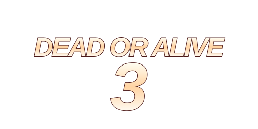
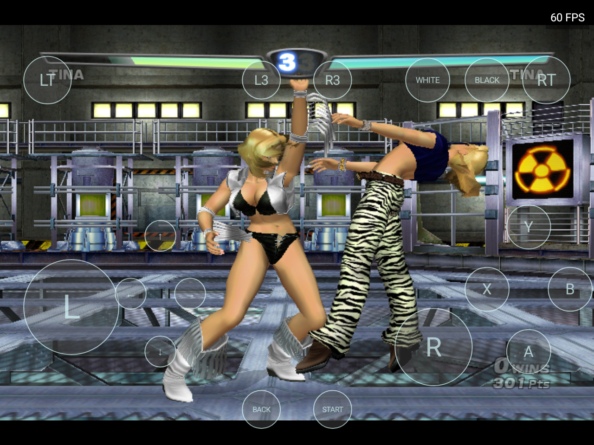
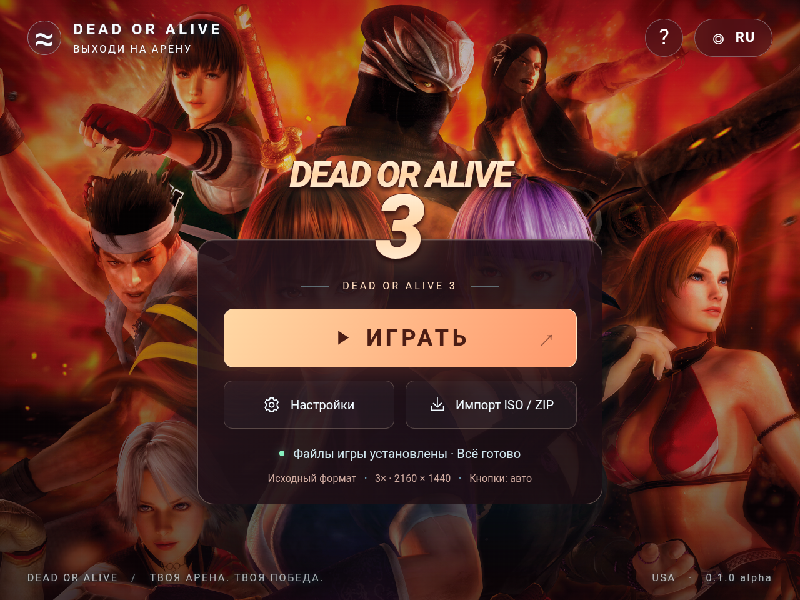
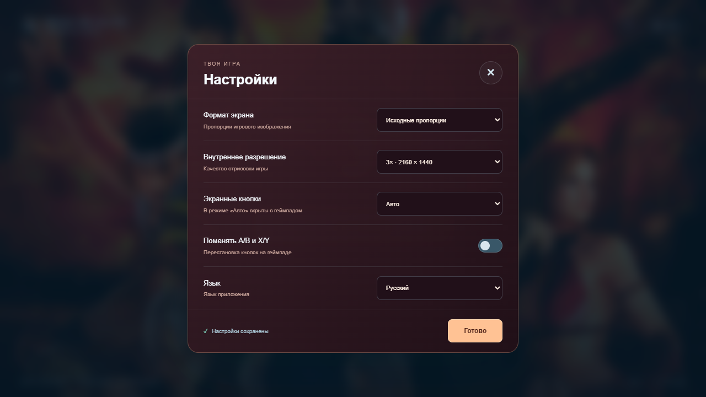

  

<h1 align="center">DOA3</h1>

<b>Dead or Alive 3 · Android · ARM64</b>

  
  
  
  

<b>Русский</b> · <a href="README.en.md">English</a>

  <a href="https://github.com/Wannamingo/DOA3/releases/download/v0.1.0-alpha1/DOA3.apk"><b>Скачать APK</b></a> ·
  <a href="https://github.com/Wannamingo/DOA3/releases">Все релизы</a> ·
  <a href="https://github.com/Wannamingo/DOA3/issues/new/choose">Сообщить об ошибке</a>

Неофициальный нативный Android-порт **Dead or Alive 3**. Игровой x86-код статически перекомпилирован для ARM64; графика использует OpenGL ES 3, звук и управление — SDL3. Лаунчер выполнен в стиле [DOAXBV](https://github.com/Wannamingo/DoAXBV), с поддержкой геймпада, экранных кнопок и импорта собственного USA ISO.

**Alpha-сборка:** запуск, меню и бой проверены на RG477M. Полное прохождение, все персонажи, арены и эффекты ещё не проверены; отдельные команды рендера могут пропускаться. Скорость зависит от сцены и устройства.

Для запуска нужна собственная оригинальная USA-копия игры. ISO, XBE и архивы игровых данных в репозитории и релизах не распространяются.

## Версия

| Компонент | Значение |
| --- | --- |
| APK | `0.1.0-alpha1` |
| Пакет Android | `org.doa3.port` |
| Нативное ядро | DOA3 USA, ARM64 |
| Проверенное устройство | RG477M, Android 14 / GammaOS, Mali-G615 MC6 |

## Возможности

- Лаунчер на русском и английском языках, с отдельным фоном и иконкой DOA3.
- Импорт напрямую из полного оригинального USA ISO; поддерживается также ZIP с соответствующими игровыми файлами.
- Проверка размеров и SHA-256 всех 24 файлов при импорте.
- Геймпад и экранные кнопки; автоматическое скрытие кнопок при подключённом геймпаде.
- Исходный формат 4:3 или отображение 16:9.
- Режимы разрешения **1×, 2× и 3×**.
- Перестановка A/B и X/Y, отдельное меню возврата в лаунчер.

| Режим | Внутреннее разрешение |
| --- | --- |
| 1× | 720 × 480 |
| 2× | 1440 × 960 |
| 3× | 2160 × 1440 |

Оригинальный буфер 720 × 480 отображается в пропорциях 4:3. Повышение внутреннего разрешения сохраняет выбранный формат экрана.

## Скриншоты

**Тестовый бой на RG477M**

| Лаунчер | Настройки |
| --- | --- |
|  |  |

## Требования

| Параметр | Требование |
| --- | --- |
| Система | Android 8.0 или новее, API 26+ |
| Архитектура | ARM64 / `arm64-v8a` |
| Графика | OpenGL ES 3.0, согласно манифесту APK |
| Игра | Оригинальная USA-версия Dead or Alive 3 |
| Место для импорта | Рекомендуется не менее 5 ГиБ свободного места сверх размера ISO |
| Размер APK | 56 145 503 байта, примерно 53,5 МиБ |

Извлечённые игровые файлы занимают 4 191 140 992 байта. Во время повторного импорта старая копия сохраняется до проверки новой; игре также требуется место для собственного кэша.

## Установка

1. Скачайте **DOA3.apk** из [релиза alpha1](https://github.com/Wannamingo/DOA3/releases/tag/v0.1.0-alpha1) и установите его.
2. Скопируйте собственный **Dead or Alive 3 (USA) (En,Ja).iso** на устройство. Проверенный полный Redump ISO имеет размер **7 825 162 240 байт**. Для такого файла используйте внутреннюю память или exFAT.
3. Откройте DOA3 и нажмите **«Импорт ISO / ZIP»**.
4. Выберите ISO и оставьте приложение открытым до завершения проверки файлов.
5. Нажмите **«ИГРАТЬ»**. После успешного импорта ISO можно удалить с устройства.

Предварительная распаковка ISO на компьютере не требуется. Другие регионы и изменённые игровые файлы этой сборкой не поддерживаются. Если файловый провайдер не позволяет открыть ISO, скопируйте его во внутреннюю память.

Обновление APK поверх установленной версии сохраняет импортированные файлы, настройки и прохождение. Повторный импорт заменяет игровые файлы и сохраняет прохождение. Удаление приложения удаляет его локальные данные.

## Управление и настройки

**Start** — игровая пауза. **Select** — меню приложения с возвратом в лаунчер. **L1 → Black**, **R1 → White**, **L2/R2 → триггеры Xbox**. Если обозначения кнопок отличаются, включите перестановку A/B и X/Y.

В настройках доступны формат экрана, внутреннее разрешение, экранные кнопки и язык лаунчера. Настройки изображения применяются при следующем запуске игры. RU/EN меняет интерфейс приложения и не переводит игровые тексты.

## Проверка и исходники

На RG477M проверены импорт исходного ISO, заставки, меню, бой, управление, пауза и звуковой вывод. Режимы 2× и 3× подтверждены тестированием владельца устройства; журнал финального APK подтверждает буфер 2160 × 1440 в режиме 3×. ARM64-тесты SIMD, fiber, сохранений, SHA и GLES завершились успешно. Подробнее — [отчёт проверки](docs/validation.md).

Опубликованы ручной runtime, Android-бэкенд, лаунчер, импортёр ISO, тесты и сценарии сборки. Сгенерированный игровой код, XBE, дисковые ресурсы и ключ подписи исключены. Полная сборка требует локального подготовленного PC-порта DOA3 и внешних инструментов; **чистый клон не является автономным комплектом сборки**. См. [состав исходников](docs/source-status.md) и [инструкцию сборки](docs/building.md).

## Ошибки и участие

[Создайте issue](https://github.com/Wannamingo/DOA3/issues/new/choose), указав версию APK, модель устройства, Android, режим разрешения и шаги воспроизведения. Изменения публичного кода можно предложить через pull request; подробности — в [CONTRIBUTING.md](CONTRIBUTING.md).

## Авторство и лицензии

Нативный runtime основан на [NoRain211/doa3-re](https://github.com/NoRain211/doa3-re); Android-бэкенд адаптирован из [DOAXBV](https://github.com/Wannamingo/DoAXBV), на основе [NoRain211/doaxvb-re](https://github.com/NoRain211/doaxvb-re). Сохранены [GNU GPL v3](LICENSE), исходные уведомления и [лицензии сторонних библиотек](THIRD_PARTY_NOTICES.md).

Проект не является официальным продуктом и не связан с правообладателями Dead or Alive. Оригинальные названия, персонажи и изображения принадлежат их правообладателям; лицензия runtime не распространяет права на эти материалы.
